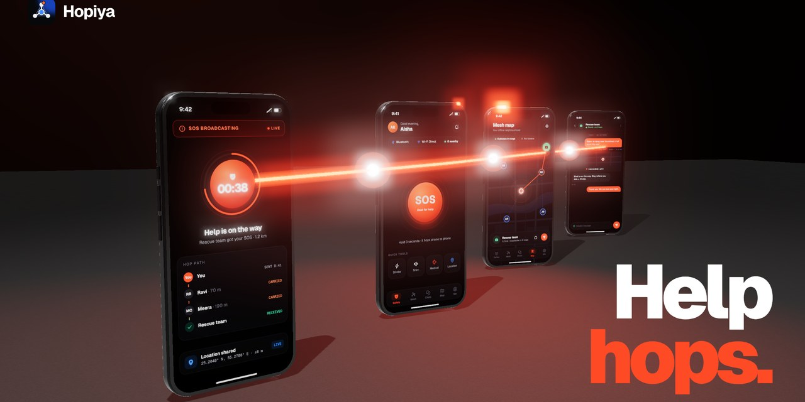
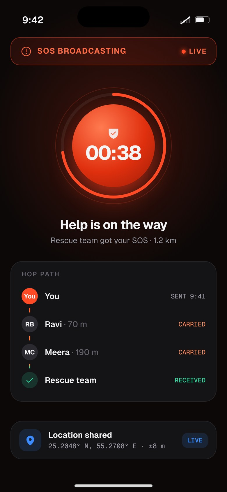
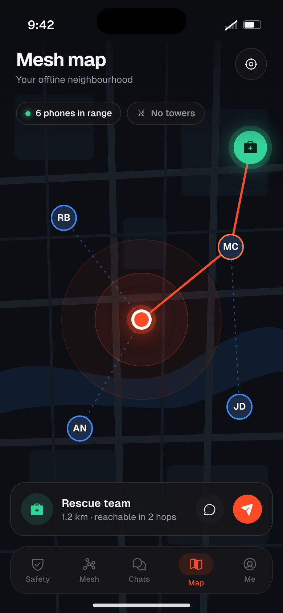
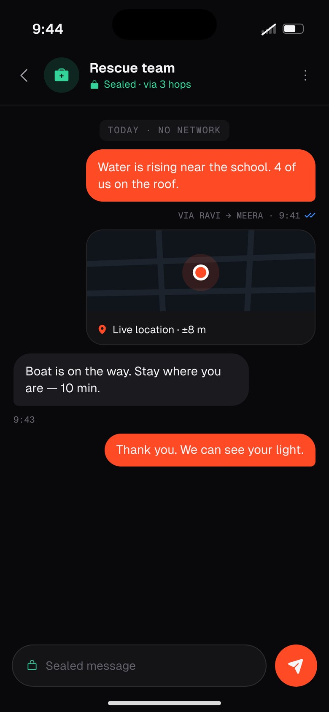
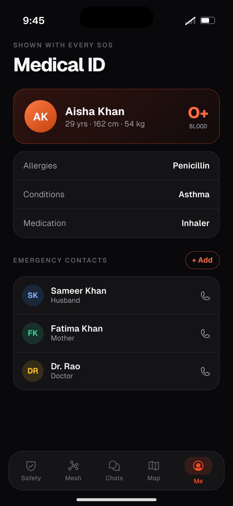

  

<h1 align="center">Hopiya</h1>

<b>When the network falls, your phone still finds help.</b> 
An offline SOS and messaging app for Android that hops phone to phone — no signal, no internet, no SIM.

  
  
  

---

## Why Hopiya

Floods, earthquakes, storms, crowded events, remote roads — the moments you need help most are often the moments the mobile network is gone. Hopiya turns every phone around you into a tower. Your message is passed from phone to phone over **Bluetooth and Wi-Fi Direct** until it reaches the person it's for.

## How a message finds help — *Ripple & Sweep*

| | Step | What happens |
|---|---|---|
| 🔒 | **Seal** | Private messages are end-to-end encrypted on your phone (X25519 + AES-256-GCM). Phones in between only carry locked bytes. |
| 〰️ | **Ripple** | Sealed copies spread along every nearby path at once — about 100 m per hop, up to 6 hops (10 for urgent SOS). |
| ✅ | **Sweep** | When the message is opened, a receipt flows back and every carrier erases its copy. Undelivered copies expire on their own. |
| 🗺️ | **Live route** | The sender watches the message travel in real time: branches, carriers, hops, time to deliver, and copies erased. |

## Features

**Emergency**
- One-press **SOS** with a 5-second cancel window — from the button, a volume-key pattern, a shake, or the app-icon shortcut
- **Medical ID** (blood group, allergies, contacts) sent with every SOS
- **Check-on-me** timer, **Rescue beacon** (Morse strobe + whistle), **Trackback** and a **Last-breath beacon** that sends your last location when the battery is about to die

**Messaging**
- Sealed private chats with the live hop route inside the chat
- Shelter and group chats for families and neighbours
- Permanent Hopiya ID with no login — add people by ID or QR code, with a safety number to verify keys

**Everyday & preparedness**
- Mesh map of nearby phones, supplies, triage, finder and shelter tools
- 21 illustrated **first-aid guides** that can be read aloud
- Store-and-forward delivery with receipts

## Screens

  
  
  
  
  

## Built with

Flutter · Dart · Google Nearby Connections (Bluetooth + Wi-Fi Direct) · X25519 / AES-256-GCM · OpenStreetMap · Android foreground service

## Download

- **Android APK:** [Releases → latest](https://github.com/Code-By-Nithin/hopiya/releases/latest)
- **Google Play:** coming soon
- Works on Android 7.0+ · free · no account · no ads · no tracking

## Source code

This repository is a **showcase only** — it does not contain the app's source code.

The complete Flutter source code (Android app, mesh engine, encryption, SOS tools and landing website) is available to purchase from **[nithindevasia.com](https://www.nithindevasia.com/innovations.php)**, with setup notes and a commercial licence. For custom builds or white-label versions for NGOs, schools, events or companies, [get in touch](https://www.nithindevasia.com/contact.php).

## Author

Designed and built by **[Nithin Devasia](https://www.nithindevasia.com)** — full-stack and mobile developer, Dubai.

---

© 2026 Nithin Devasia. All rights reserved. See <a href="LICENSE">LICENSE</a>.
