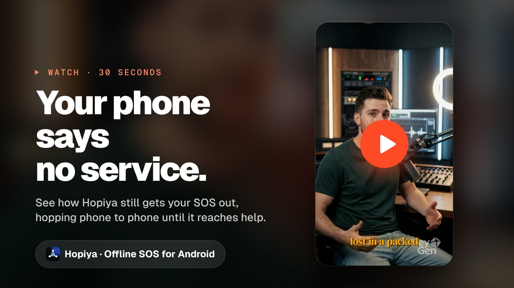
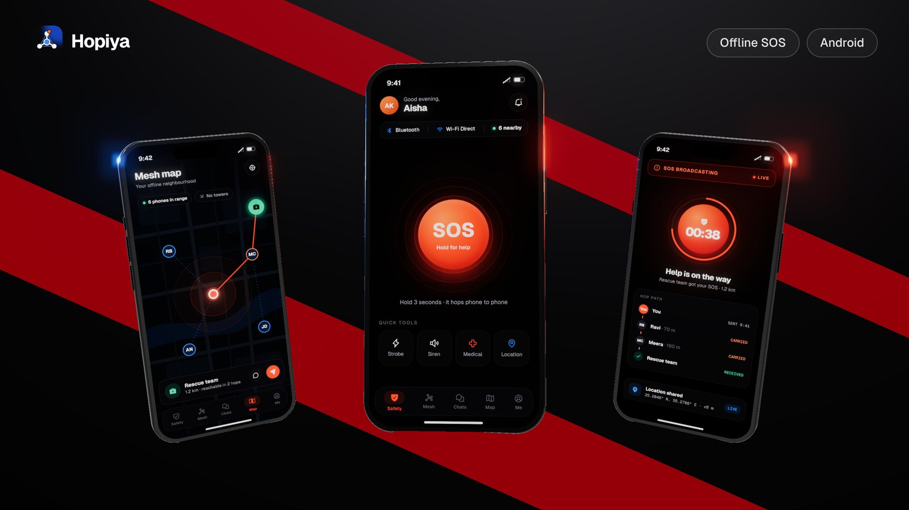
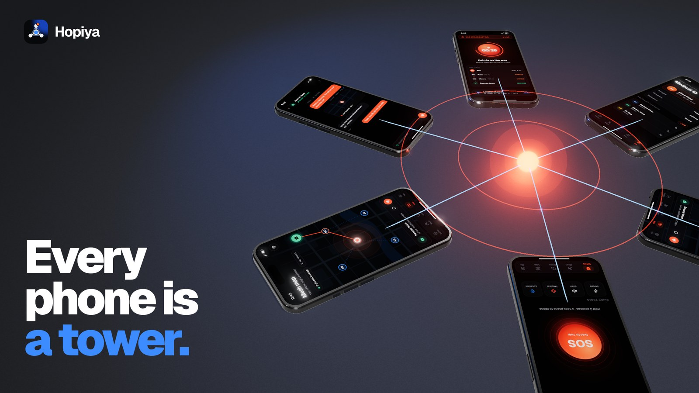
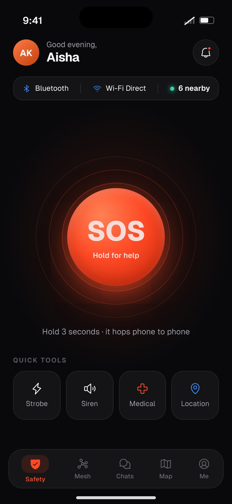
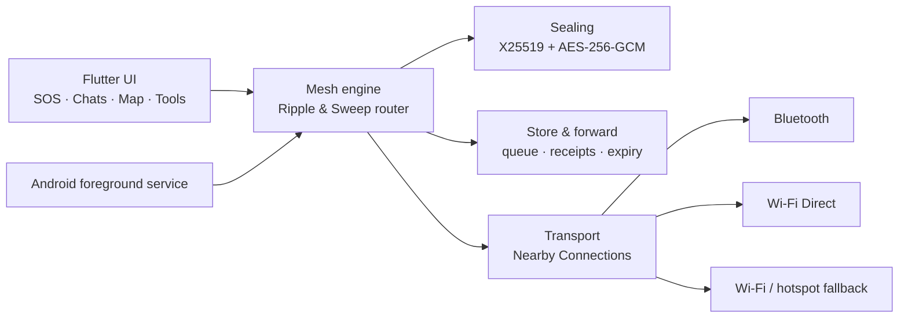

<p align="center">
  
</p>

<h1 align="center">Hopiya</h1>
<p align="center"><b>When the network falls, your phone still finds help.</b><br>
An offline SOS and messaging app for Android that hops phone to phone — no signal, no internet, no SIM.</p>

<p align="center">
  <a href="https://github.com/Code-By-Nithin/hopiya/releases/latest"></a>
  <a href="https://www.nithindevasia.com/innovations.php"></a>
  
  
</p>

<p align="center">
  <a href="#%EF%B8%8F-watch-hopiya-in-30-seconds">Video</a> ·
  <a href="#-why-hopiya">Why</a> ·
  <a href="#-how-a-message-finds-help">How it works</a> ·
  <a href="#-features">Features</a> ·
  <a href="#-screens">Screens</a> ·
  <a href="#-architecture">Architecture</a> ·
  <a href="#-install">Install</a> ·
  <a href="#-privacy--security">Privacy</a> ·
  <a href="#-faq">FAQ</a> ·
  <a href="#-get-the-source-code">Source code</a>
</p>

> **This repository is a showcase.** It contains the description, screenshots, artwork and the downloadable app — **not the source code**. The complete source code is sold separately at **[nithindevasia.com](https://www.nithindevasia.com/innovations.php)**.

## ▶️ Watch: Hopiya in 30 seconds

<p align="center">
  <a href="media/hopiya-promo.mp4"></a>
</p>
<p align="center"><sub>Click the image to play the video · <a href="media/hopiya-promo.mp4">hopiya-promo.mp4</a> (vertical, 32 s, AI-generated presenter)</sub></p>

---

## 💡 Why Hopiya

Floods, earthquakes, storms, power cuts, crowded stadiums, desert roads, mountain treks — the moments you most need help are often the moments the mobile network is gone or jammed.

Hopiya turns **every phone around you into a tower**. Your message is passed from phone to phone over **Bluetooth and Wi-Fi Direct** — about 100 m per hop — until it reaches the person it's for. No towers, no internet, no SIM card and no account are needed.

**Built for**

| | |
|---|---|
| 🏠 **Families & neighbours** | Stay reachable during floods, storms and outages |
| 🏫 **Schools & campuses** | Roll call and alerts when networks are down |
| 🏟️ **Events & festivals** | Message friends when the crowd jams the network |
| 🧗 **Travellers & trekkers** | SOS where there's no coverage |
| 🚑 **NGOs & rescue teams** | Receive SOS with location and Medical ID from the field |

<p align="center"></p>

## 〰️ How a message finds help

Hopiya uses its own delivery protocol, **Ripple & Sweep**:

| Step | Name | What happens |
|:---:|---|---|
| 1 | 🔒 **Seal** | The message is end-to-end encrypted on your phone (X25519 key exchange + AES-256-GCM). Phones in between only ever hold locked bytes. |
| 2 | 〰️ **Ripple** | Sealed copies spread along every nearby path at the same time — up to **6 hops** for normal messages and **10 hops** for an urgent SOS. |
| 3 | ✅ **Sweep** | When the receiver opens it, a delivery receipt flows back and **every carrier erases its copy**. Late copies are dropped. |
| 4 | ⏳ **Expire** | Copies that can't be delivered expire on their own (6 hours, 24 hours or 3 days, by priority). |
| 5 | 🗺️ **Live route** | Carriers report "caught it from X at hop N", so the sender watches the delivery tree grow in real time: branches, carriers, hops, time to deliver and copies erased. |

```
 You ──▶ Ravi ──▶ Meera ──▶ Rescue team      (winning path, 3 hops)
   └───▶ Amina ──▶ Joseph ─┘                  (parallel copy, erased after delivery)
```

<p align="center"></p>

## ✨ Features

### 🆘 Emergency
- **One-press SOS** — hold the button, shake the phone, press a volume-key pattern or use the app-icon shortcut
- **5-second cancel window** so pocket presses don't raise false alarms
- **Location attached** to every SOS
- **Medical ID** — blood group, allergies, conditions, medication and emergency contacts go out with the alert
- **Check-on-me timer** — if you don't check in on time, your circle is alerted
- **Rescue beacon** — Morse-code SOS strobe and whistle to guide rescuers to you
- **Trackback** — retrace your path
- **Last-breath beacon** — when the battery is almost empty, your last location goes out to the mesh automatically

### 💬 Messaging
- **Sealed private chats** with the live hop route shown inside the chat
- **Shelter & group chats** for families, neighbours and teams
- **Permanent Hopiya ID** with no sign-up — add people by ID or by scanning their QR code
- **Safety numbers** to verify each contact's keys
- **Delivery receipts** and store-and-forward, so messages wait for a path instead of failing

### 🧰 Preparedness
- **Mesh map** of phones in range and the route to help
- **Supplies, triage, finder and shelter** tools
- **21 illustrated first-aid guides** that can be read aloud
- Works fully offline; downloads map tiles when internet is available

## 📱 Screens

<p align="center">
  
  
  
  
  
</p>

| Home & SOS | Live SOS | Mesh map | Sealed chat | Medical ID |
|---|---|---|---|---|
| Hold-to-send SOS, nearby phones, quick tools | Countdown, hop path, shared location | Phones in range and the route to rescue | Encrypted messages with hop route | Shown with every SOS |

## 🏗️ Architecture



| Layer | Technology |
|---|---|
| App | Flutter · Dart |
| Transport | Google Nearby Connections (Bluetooth, Wi-Fi Direct) with Wi-Fi/hotspot fallback |
| Security | X25519 key exchange, AES-256-GCM, per-contact safety numbers |
| Background | Android foreground service keeps the mesh alive |
| Maps | OpenStreetMap tiles with offline cache |
| Website | HTML · CSS · JavaScript (live-sky theming) |

## 📲 Install

1. Download **`hopiya-1.0.0.apk`** from **[Releases](https://github.com/Code-By-Nithin/hopiya/releases/latest)** on your Android phone.
2. Allow **Install unknown apps** for your browser or file manager when asked.
3. Open Hopiya and allow **Nearby devices, Location and Notifications** — the mesh needs them to find phones around you.
4. Install it on at least one more phone nearby to see messages hop.

**Requirements:** Android 7.0 or newer with Google Play services. Phones without Google Play services (for example recent Huawei models) can't join the mesh. Google Play release: coming soon.

### Permissions explained

| Permission | Why |
|---|---|
| Nearby devices / Bluetooth / Wi-Fi | Find and connect to other Hopiya phones |
| Location | Required by Android for nearby discovery, and attached to your SOS |
| Notifications | Alert you to messages and SOS calls |
| Camera | Scan a friend's QR code only |
| Run in background | Keep relaying messages while the app is closed |

## 🔐 Privacy & security

- **No account, no phone number, no email** — your Hopiya ID is created on the phone
- **No servers** — messages travel only between phones
- **Carriers can't read** what they carry, and **wipe it** after delivery
- **No ads, no analytics, no data selling**
- Full policy: [Privacy policy](https://www.nithindevasia.com/innovations.php)

## ❓ FAQ

<details><summary><b>Does it really work with zero signal?</b></summary>
Yes. Hopiya talks directly to other phones over Bluetooth and Wi-Fi Direct. It needs other Hopiya phones within about 100 m to pass the message on.</details>

<details><summary><b>How far can a message travel?</b></summary>
About 100 m per hop, and up to 6 hops (10 for SOS) — the more phones running Hopiya around you, the further it reaches.</details>

<details><summary><b>Can the phones that carry my message read it?</b></summary>
No. Private messages are sealed on your phone; carriers only hold encrypted bytes and erase them after delivery.</details>

<details><summary><b>Does it drain the battery?</b></summary>
The mesh runs as a foreground service tuned for low power. The last-breath beacon sends your location before the battery runs out.</details>

<details><summary><b>Is it free?</b></summary>
Yes — the app is free with no ads. Only the source code is paid.</details>

## 🗺️ Roadmap

- [x] Mesh messaging, SOS, Medical ID, safety tools, first aid
- [ ] Walkie-talkie voice over the mesh
- [ ] Offline map tile packs
- [ ] Sync to the cloud when internet returns
- [ ] First aid in Malayalam, Hindi, Tamil and Arabic
- [ ] Google Play release

## 🛒 Get the source code

The complete source code is **not in this repository**. It's available to buy from **[nithindevasia.com](https://www.nithindevasia.com/innovations.php)** for **AED 1,100**.

| Included | |
|---|---|
| ✅ Full Flutter app source (Android) | Mesh engine, Ripple & Sweep routing, sealed chats, SOS tools, Medical ID, first aid, map |
| ✅ Landing website | HTML/CSS/JS with live-sky theming |
| ✅ Buyer guide | Setup, rebranding, release builds, troubleshooting |
| ✅ Commercial licence | Use in your own and your clients' projects |
| ❌ Not included | Signing keys; the Hopiya name, app ID and logo for publishing |

**Custom builds** — white-label versions for NGOs, schools, events or companies: [contact Nithin](https://www.nithindevasia.com/contact.php).

## 👤 Author

Designed and built by **[Nithin Devasia](https://www.nithindevasia.com)** — full-stack and mobile developer, Dubai.

---

<sub>© 2026 Nithin Devasia. All rights reserved. This repository contains promotional material only — see <a href="LICENSE">LICENSE</a>.</sub>
